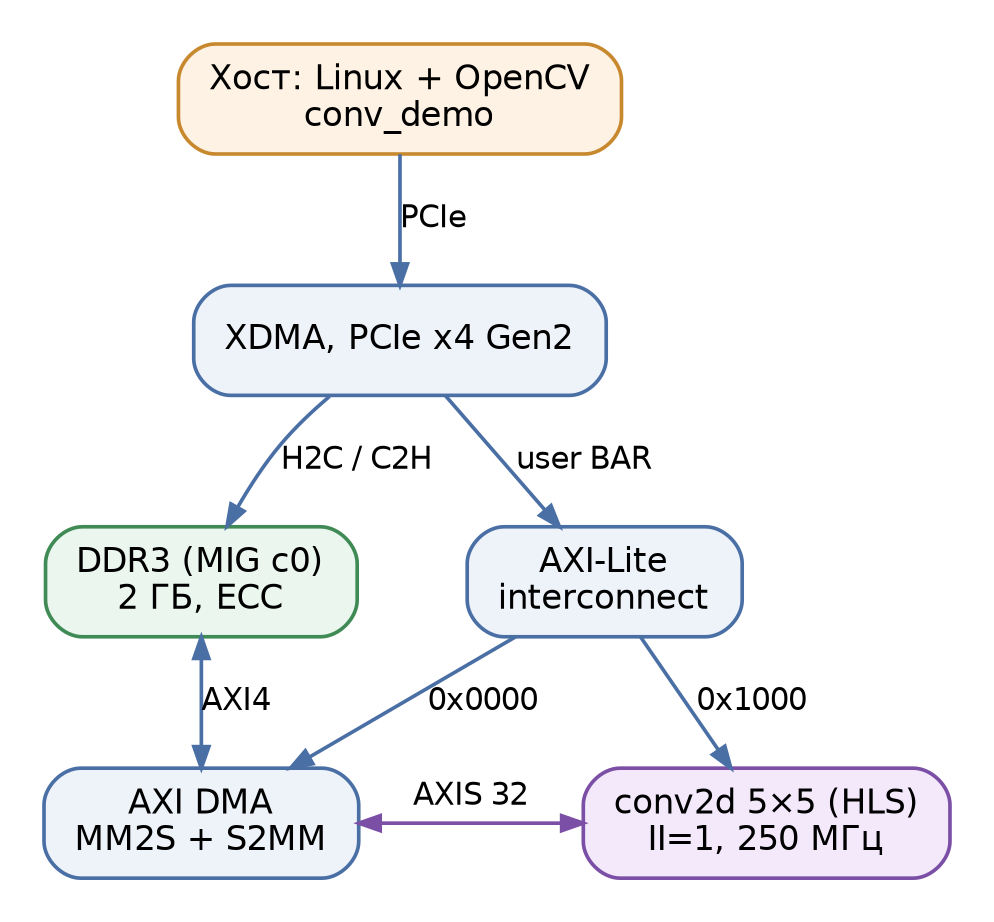
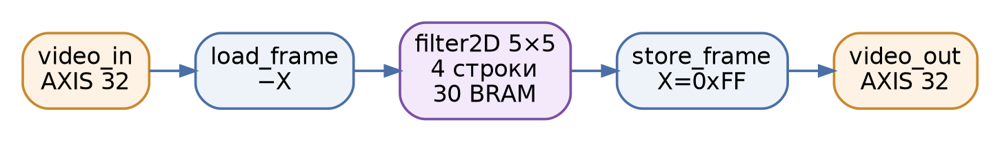
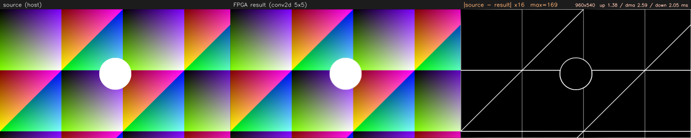

# ВВЕДЕНИЕ

Настоящий документ описывает версию 1 платформы ускорения покадровой обработки видео на отладочной плате YPCB-00338-1P1 с ПЛИС Kintex-7 XC7K480T. Документ фиксирует состояние на 15.11.2026: состав аппаратной части, архитектуру тракта данных, интерфейсы ядра свёртки, программный интерфейс, измеренные характеристики и известные ограничения.

Платформа предназначена для переноса вычислительно тяжёлых операций обработки изображений с центрального процессора на ПЛИС при сохранении привычного программного интерфейса: приложение на C++ с OpenCV получает и возвращает обычный кадр `cv::Mat`, а обработка выполняется в программируемой логике.

В версии 1 реализован и проверен полный сквозной тракт: кадр с хоста передаётся по PCIe в DDR3 на плате, проходит через потоковое HLS-ядро свёртки 5×5, возвращается в DDR3 и читается хостом. Результат работы ядра совпадает с программным эталоном бит в бит на разрешениях 640×480, 1280×720 и 1920×1080, в том числе на реальном кадре с камеры.

Документ предназначен для инженеров, которые будут развивать платформу: добавлять новые ядра, менять разрядность тракта, подключать оптическую стабилизацию. Раздел 9 содержит перечень уже пройденных подводных камней, чтобы не повторять их.

# 1 ОБЩИЕ СВЕДЕНИЯ

## 1.1 Назначение и область применения

Платформа выполняет потоковую обработку кадров, поступающих с хоста, и возвращает результат на хост. Источником кадров может быть веб-камера, файл или синтетический генератор; принципиально важен лишь формат: 8 бит на канал, три канала цвета.

Типовой сценарий применения — предобработка видеопотока перед анализом: размытие для подавления шума, повышение резкости, выделение границ, а в перспективе — плотный оптический поток и аффинная стабилизация изображения.

В текущую версию не входят захват видео с интерфейсов HDMI или SDI и вывод на дисплей: поток формируется программно на хосте. Это сознательное ограничение этапа, а не свойство архитектуры.

## 1.2 Состав версии

| Компонент | Расположение | Назначение |
|:----------|:-------------|:-----------|
| Битстрим | `hw/accel.runs/impl_1/top_wrapper.bit` | конфигурация ПЛИС |
| Образ флеша | `hw/accel.runs/impl_1/top_wrapper.mcs` | загрузка из BPI-флеша |
| Проект Vivado | `hw/accel.xpr`, BD `top` | сборка аппаратной части |
| HLS-ядро | `hls/kernels/conv2d/`, `hw/ip_repo/conv2d` | свёртка 5×5, версия 2.0 |
| Библиотека хоста | `host/include`, `host/src` | доступ к PCIe, DMA, регистрам |
| Демонстрационное приложение | `host/apps/conv_demo.cpp` | камера, окно, сверка с эталоном |
| Скрипты сборки и прошивки | `scripts/` | воспроизводимая сборка |
| Документация | `docs/` | факты, измерения, ограничения |
Таблица: Состав поставки

Версия соответствует коммиту `0cb6c5c` репозитория проекта.

## 1.3 Сокращения

| Сокращение | Расшифровка |
|:-----------|:------------|
| ПЛИС | программируемая логическая интегральная схема |
| BD | block design, блок-дизайн Vivado |
| IP | intellectual property, готовый аппаратный блок |
| HLS | high-level synthesis, синтез из C++ |
| AXI4 | шина памяти с пакетными пересылками |
| AXIS | AXI4-Stream, поток без адресов |
| AXI-Lite | упрощённая шина для регистров |
| DMA | direct memory access, прямой доступ к памяти |
| DDR3 | динамическая память с удвоенной скоростью |
| MIG | memory interface generator, контроллер памяти |
| II | initiation interval, тактов на один элемент |
| BRAM | блочная память ПЛИС |
| WNS | worst negative slack, худший запас по таймингу |
Таблица: Сокращения и обозначения

# 2 АРХИТЕКТУРА ПЛАТФОРМЫ

## 2.1 Общая схема

Платформа разделена на три мира: программный (хост), транспортный (PCIe и XDMA) и аппаратный (ПЛИС). Внутри ПЛИС, в свою очередь, разделены тракт данных и тракт управления.



Тракт данных работает с кадрами: DDR3 хранит входной и выходной кадры, AXI DMA переносит их между памятью и потоком, ядро обрабатывает поток. Тракт управления работает с отдельными 32-битными регистрами через AXI-Lite: хост настраивает адреса и длины пересылок, а также параметры ядра.

Разделение важно понимать буквально: данные и управление идут по разным физическим каналам и не мешают друг другу. Именно поэтому можно, например, менять разрешение кадра на каждом кадре, не перестраивая тракт.

## 2.2 Путь одного кадра

1. Приложение получает кадр в формате BGR8 (три байта на пиксель).
2. Кадр расширяется до BGRA (четыре байта на пиксель); причина описана в разделе 2.4.
3. Буфер записывается в `/dev/xdma0_h2c_0` по адресу `0x1000_0000` — это DDR3 на плате.
4. Хост программирует AXI DMA: адрес источника, адрес приёмника, затем длину пересылки.
5. Канал MM2S читает DDR3 и выдаёт поток AXI4-Stream: один 32-битный пиксель за такт, сигнал TLAST на последнем пикселе кадра.
6. Ядро `conv2d` принимает поток, выполняет свёртку 5×5 и выдаёт результат в том же формате.
7. Канал S2MM принимает поток и записывает его в DDR3 по адресу `0x2000_0000`.
8. Хост читает результат из `/dev/xdma0_c2h_0`, сужает BGRA обратно до BGR и получает `cv::Mat`.

Время полного цикла складывается из трёх составляющих: запись кадра на плату, работа конвейера на плате, чтение кадра с платы. Для 1280×720 это примерно 2,4 мс, 1,9 мс и 3,6 мс соответственно.

## 2.3 Тракт управления

Хост видит плату как PCIe-устройство с двумя 64-килобайтными областями BAR. Первая область отведена под DMA-движки XDMA и служебные регистры, вторая — под пользовательские устройства. XDMA предоставляет мастер AXI-Lite, который транслирует обращения к пользовательской области в шину AXI-Lite внутри ПЛИС.

Внутри этой шины стоит interconnect с двумя выходами. Первый выход ведёт к регистрам AXI DMA по адресу `0x0000`, второй — к регистрам ядра по адресу `0x1000`. Каждому устройству отведено по 4 КБ, чего с большим запасом хватает: регистры DMA занимают 92 байта, регистры ядра — 40 байт.

Программная часть обращается к этим регистрам через отображение пользовательской области в память процесса: 64 КБ отображены один раз, далее доступ идёт обычными 32-битными чтениями и записями по смещениям.

## 2.4 Принятые решения и их причины

Разрядность потока выбрана равной 32 битам, хотя кадр занимает 24 бита на пиксель. Причина в том, что AXI DMA в простом режиме поддерживает только степень двойки: 8, 16, 32, 64 бита и выше. Ширина 24 бита недопустима. Поэтому кадр расширяется до RGBX, где X равен 0xFF, а внутри ядра лишний байт отбрасывается. Плата за решение — треть лишнего трафика по PCIe.

Кадры хранятся в DDR3, а не в блочной памяти ПЛИС. Кадр 4K в формате RGBX занимает 33 МБ, что несоизмеримо с 4,3 МБ блочной памяти кристалла. DDR3 через MIG даёт 2 ГБ и полностью решает задачу буферизации.

AXI DMA используется в простом режиме, без цепочки дескрипторов. Для покадровой обработки это оптимально: одна пересылка равна одному кадру, дескрипторы не нужны, а максимальная длина пересылки (64 МБ) с запасом покрывает 4K.

# 3 АППАРАТНАЯ ПЛАТФОРМА

## 3.1 Плата и кристалл

| Параметр | Значение |
|:---------|:---------|
| Плата | YPCB-00338-1P1 (DU-PCB-001-003) |
| ПЛИС | Kintex-7 XC7K480T-FFG1156-2 |
| Логические ресурсы | 298 600 LUT, 597 200 FF, 955 BRAM, 1920 DSP |
| PCIe | x8 Gen2 (аппаратный блок), слот предоставляет x4 Gen3 |
| Флеш | Micron MT28GU512AAA, 512 Мбит, x16, 1,8 В, BPI |
| DDR3 | два канала, MIG с ECC (72 бита), AXI 512 бит |
| Питание | только из слота PCIe, лимит слота около 26 Вт |
Таблица: Основные параметры платы

## 3.2 Состав блок-дизайна

| Модуль | Роль | Ключевые параметры |
|:-------|:-----|:-------------------|
| `xdma_0` | PCIe-мост | x8 Gen2 в конфигурации, линк x4; BAR0 64 КБ |
| `mig_7series_0` | контроллер DDR3 | два канала, ECC, UI-частота 133 МГц |
| `axi_smc` | SmartConnect данных | 4 ведущих порта, 2 ведомых (MIG c0, c1) |
| `axi_dma_0` | пересылка кадров | простой режим, память 64 бита, поток 32 бита |
| `conv2d_0` | ядро свёртки | HLS, версия 2.0, 250 МГц |
| `axi_lite` | interconnect управления | 1 ведущий, 2 ведомых порта |
| `microblaze_0` | служебный процессор | наследие вендорского примера, не используется |
Таблица: Состав блок-дизайна

## 3.3 Тактирование

| Домен | Частота | Что тактируется |
|:------|:--------|:----------------|
| `xdma_0_axi_aclk` | 250 МГц | XDMA, AXI DMA, ядро, AXI-Lite, S02/S03 SmartConnect |
| `mig_0_c0_ui_clk` | 133 МГц | контроллер DDR3 канала 0 |
| `microblaze_0_Clk` | 100 МГц | служебный процессор и периферия |
Таблица: Тактовые домены

Все пять тактовых входов AXI DMA и оба входа ядра (тактовый и сброс) подключены к домену 250 МГц. Это снимает необходимость в пересинхронизации потоков: ядро и DMA работают в одном домене, обмен идёт без потерь тактов.

## 3.4 Карта адресов

| Пространство | Адрес | Размер | Что |
|:-------------|:------|:-------|:----|
| user BAR | `0x0000` | 4 КБ | регистры AXI DMA |
| user BAR | `0x1000` | 4 КБ | регистры ядра conv2d |
| AXI (XDMA) | `0x0000_0000` | 2 ГБ | DDR3 канал 0 |
| AXI (XDMA) | `0x8000_0000` | 2 ГБ | DDR3 канал 1 |
| DDR3 | `0x1000_0000` | кадр | входной кадр |
| DDR3 | `0x2000_0000` | кадр | выходной кадр |
Таблица: Карта адресов

Драйвер XDMA использует смещение в операциях чтения и записи как AXI-адрес платы, поэтому в программе адреса DDR3 указываются напрямую.

## 3.5 Ресурсы и тайминг

| Ресурс | Занято | Всего | Доля |
|:-------|-------:|------:|-----:|
| LUT | 66 000 | 298 600 | 22 % |
| FF | 72 000 | 597 200 | 12 % |
| BRAM | 185 | 955 | 19 % |
| DSP | 7 | 1920 | 0,4 % |
Таблица: Ресурсы и тайминг проекта

Итоговая сборка закрывает тайминг с запасом WNS +0,006 нс на частоте 250 МГц. Запас невелик и определяется внутренними путями блока PCIe; при добавлении логики стратегию реализации следует проверять заново.

## 3.6 Загрузка из флеша

Флеш подключён по синхронному интерфейсу BPI x16. В файле ограничений заданы режим синхронизации Type1, частота конфигурирования 33 МГц, напряжение банков 1,8 В. Без синхронного режима флеш не читается, без повышенной частоты конфигурирование занимает около 52 секунд вместо пяти.

Образ для флеша формируется только в формате MCS: двоичный образ приводит к ошибке загрузки. Запись производится служебным битстримом доступа к BPI, который поставляется с Vivado и должен быть распакован вручную.

# 4 ЯДРО СВЁРТКИ conv2d

## 4.1 Алгоритм

Ядро выполняет линейную фильтрацию с ядром 5×5 и целочисленной нормализацией:

$$ g(x,y) = \min\left(255,\ \max\left(0,\ \left\lfloor \frac{1}{2^{s}} \sum_{i=0}^{4}\sum_{j=0}^{4} k_{ij}\, f(x+i-2,\ y+j-2) \right\rfloor \right)\right) $$

Сумма коэффициентов равна 256, показатель нормализации равен 8, что даёт единичный коэффициент усиления: однородная область сохраняет яркость без переполнения.

| 1 | 4 | 6 | 4 | 1 |
|:--:|:--:|:--:|:--:|:--:|
| 4 | 16 | 24 | 16 | 4 |
| 6 | 24 | 36 | 24 | 6 |
| 4 | 16 | 24 | 16 | 4 |
| 1 | 4 | 6 | 4 | 1 |
Таблица: Коэффициенты ядра (сумма 256)


На границах кадра применяется нулевое заполнение: пиксели за пределами изображения считаются нулевыми. Это соответствует поведению библиотечной функции `xf::cv::filter2D` версии 2024.2 и подтверждено симуляцией.

## 4.2 Микроархитектура

Ядро построено как конвейер из трёх процессов, работающих одновременно благодаря директиве DATAFLOW.



Процесс `load_frame` читает поток, отбрасывает байт X и записывает пиксели в канал `src`. Процесс `filter2D` хранит четыре строки изображения в линейных буферах и формирует результат в канал `dst`; полный кадр в памяти не размещается, поэтому 4K помещается в кристалл. Процесс `store_frame` читает канал `dst`, восстанавливает байт X равным 0xFF, выставляет TLAST на последнем пикселе и выдаёт поток.

Все три цикла имеют показатель II, равный единице: каждый такт обрабатывается один пиксель. При 250 МГц это 250 миллионов пикселей в секунду, что соответствует кадру 4K с частотой 30 кадров в секунду.

## 4.3 Интерфейсы

| Порт | Тип | Разрядность | Назначение |
|:-----|:----|:------------|:-----------|
| `video_in` | AXI4-Stream | 32 | входной поток RGBX |
| `video_out` | AXI4-Stream | 32 | выходной поток RGBX, TLAST на последнем пикселе |
| `s_axi_control` | AXI4-Lite | 32 | регистры управления |
| `ap_clk` | тактирование | 1 | 250 МГц |
| `ap_rst_n` | сброс | 1 | активный низкий |
Таблица: Интерфейсы ядра

## 4.4 Регистры управления

| Смещение | Имя | Доступ | Назначение |
|:---------|:----|:-------|:-----------|
| `0x00` | CTRL | чтение/запись | бит 0 — пуск, бит 1 — готовность |
| `0x04` | GIE | чтение/запись | глобальное разрешение прерываний |
| `0x08` | IER | чтение/запись | разрешение прерываний |
| `0x0C` | ISR | чтение/запись | флаги прерываний |
| `0x10` | ROWS | чтение/запись | высота кадра в пикселях |
| `0x18` | COLS | чтение/запись | ширина кадра в пикселях |
| `0x20` | SHIFT | чтение/запись | показатель нормализации |
Таблица: Регистры управления ядра

Последовательность запуска одного кадра: записать ROWS, COLS и SHIFT, установить бит пуска, затем запустить пересылку DMA ожидать одновременно завершения пересылки и установки бита готовности ядра. Параметры читаются ядром в момент пуска, поэтому их можно менять между кадрами.

## 4.5 Ресурсы и частота

| Параметр | Значение |
|:---------|:---------|
| Показатель II | 1 |
| Линейные буферы | 30 блоков BRAM |
| Триггеры | 6722 |
| Табличные блоки | 5596 |
| Цифровые сигнальные процессоры | 4 |
| Оценка периода синтеза | 4,75 нс (210 МГц) |
| Рабочая частота в проекте | 250 МГц |
Таблица: Ресурсы ядра

Оценка периода синтеза относится к внутренним путям ядра до оптимизации размещением и трассировкой; в составе проекта ограничение 4 нс выполняется по всем путям.

## 4.6 Форматы данных

| Поле | Биты | Содержимое |
|:-----|:-----|:-----------|
| B | 7:0 | синий канал |
| G | 15:8 | зелёный канал |
| R | 23:16 | красный канал |
| X | 31:24 | не используется, на выходе 0xFF |
Таблица: Форматы данных

На входе ядро игнорирует байт X, на выходе всегда выставляет 0xFF. Благодаря этому промежуточный формат совместим с форматом BGRA библиотеки OpenCV, и преобразования на хосте сводятся к одному вызову.

# 5 ПРОГРАММНОЕ ОБЕСПЕЧЕНИЕ

## 5.1 Устройства

| Устройство | Назначение |
|:-----------|:-----------|
| `/dev/xdma0_h2c_0` | запись в память платы (host to card) |
| `/dev/xdma0_c2h_0` | чтение из памяти платы (card to host) |
| `/dev/xdma0_user` | пользовательская область BAR, регистры |
| `/dev/xdma0_control` | служебные регистры XDMA |
Таблица: Устройства XDMA

## 5.2 Карта регистров платформы

| Адрес | Устройство | Назначение |
|:------|:-----------|:-----------|
| `0x0000` | AXI DMA | управление каналом MM2S |
| `0x0004` | AXI DMA | состояние канала MM2S |
| `0x0018` | AXI DMA | адрес источника |
| `0x0028` | AXI DMA | длина пересылки MM2S (запись запускает) |
| `0x0030` | AXI DMA | управление каналом S2MM |
| `0x0034` | AXI DMA | состояние канала S2MM |
| `0x0048` | AXI DMA | адрес приёмника |
| `0x0058` | AXI DMA | длина пересылки S2MM |
| `0x1000` | ядро | CTRL |
| `0x1010` | ядро | ROWS |
| `0x1018` | ядро | COLS |
| `0x1020` | ядро | SHIFT |
Таблица: Карта регистров платформы

## 5.3 Библиотека хоста

| Класс | Файл | Назначение |
|:------|:-----|:-----------|
| `Xdma` | `xdma.hpp` | позиционируемые чтение и запись через char-устройства |
| `UserBar` | `userbar.hpp` | отображение пользовательской области 64 КБ |
| `Axidma` | `axidma.hpp` | сброс, запуск и опрос AXI DMA |
| `Conv2d` | `conv2d.hpp` | параметры и запуск ядра |
| `IVideoPipeline` | `pipeline.hpp` | общий интерфейс обработки кадра |
| `AxidmaConv2d` | `pipeline.hpp` | сквозной тракт с ядром свёртки |
Таблица: Классы библиотеки хоста

Интерфейс `IVideoPipeline` объявляет единственный метод `process`, принимающий кадр и возвращающий кадр. Приложение не знает, что находится внутри: аппаратный тракт, программный обход или будущая реализация с другим ядром подставляются заменой одного класса.

## 5.4 Приложение conv_demo

| Ключ | Назначение |
|:-----|:-----------|
| `--camera N` | источник — камера с номером N |
| `--synthetic` | источник — синтетический движущийся шаблон |
| `--width`, `--height` | запрашиваемое разрешение |
| `--dma` | включить аппаратный тракт с ядром |
| `--verify` | сверить с программным эталоном на первом кадре |
| `--compare` | окно с источником, результатом и разностью |
| `--headless` | без окна, сохранить кадр в файл |
| `--frames N` | ограничить число кадров |
| `--out DIR` | каталог для сохранения |
Таблица: Ключи приложения conv_demo

Типовой запуск с камерой:

```bash
cd conv_accel/host
./run_demo.sh --camera 0 --width 1280 --height 720 --dma --verify --compare
```

Запуск без окна, с сохранением результата:

```bash
./run_demo.sh --camera 0 --dma --verify --headless --frames 1 --out /tmp
```

Скрипт-обёртка `run_demo.sh` нужен из-за особенности окружения: в системе рассинхронизированы схемы GSettings, из-за чего Qt-тема GTK3 аварийно завершает процесс при старте. Скрипт собирает приватную копию схем в кэше пользователя и подставляет её через переменную окружения; системные файлы не изменяются.

# 6 ПРОИЗВОДИТЕЛЬНОСТЬ

## 6.1 Транспорт PCIe и DDR3

| Объём | Запись на плату | Чтение с платы |
|:------|----------------:|---------------:|
| 1 МБ | 1414 МБ/с | 1446 МБ/с |
| 24 МБ | 1511 МБ/с | 1532 МБ/с |
| 64 МБ | 1532 МБ/с | 1541 МБ/с |
Таблица: Пропускная способность транспорта

Линк согласован на x4 Gen2, что даёт теоретические 2 ГБ/с на направление и около 1,5 ГБ/с полезной нагрузки. Это и есть главное ограничение для больших разрешений.

## 6.2 Сквозной конвейер

| Кадр | Запись | Конвейер | Чтение | Итого | Кадров в секунду |
|:-----|-------:|---------:|-------:|------:|-----------------:|
| 640×480 | 0,8 мс | 1,7 мс | 1,2 мс | 3,7 мс | 72 |
| 1280×720 | 2,4 мс | 1,9 мс | 3,6 мс | 7,9 мс | 58 |
| 1920×1080 | 5,4 мс | 2,0 мс | 8,3 мс | 15,7 мс | 16 |
Таблица: Производительность сквозного конвейера

Обработка на плате занимает около двух миллисекунд независимо от разрешения вплоть до 1080p: конвейер ограничен не вычислениями, а транспортом. Для 4K оценка полного цикла составляет около 53 мс, то есть примерно 8 кадров в секунду, причём почти всё время приходится на пересылку 33 МБ в каждую сторону.

## 6.3 Внешняя камера

Встроенная камера подключена по USB 2.0 и выдаёт около 8,5 кадров в секунду при любом разрешении: 640×480, 848×480 и 1280×720 дают одинаковый результат. Это означает ограничение по выдержке, а не по полосе интерфейса: в слабом освещении автоэкспозиция удлиняет кадр. При ярком освещении камера выходит на паспортные 30 кадров в секунду, и тогда ограничением становится транспорт PCIe.

## 6.4 Оценка бюджета

Время пересылки кадра определяется выражением:

$$ t_{frame} = \frac{2 \, W H b}{B_{PCIe}} $$

где `W` и `H` — размеры кадра, `b` — число байт на пиксель, `B` — пропускная способность линка. Множитель два учитывает передачу кадра на плату и обратно. Для 4K в формате RGBX при 1,5 ГБ/с получается около 44 мс только на транспорт.

# 7 СБОРКА, ПРОШИВКА, ЗАПУСК

## 7.1 Инструменты

| Инструмент | Версия | Назначение |
|:-----------|:-------|:-----------|
| Vivado | 2024.2 | проект, синтез, реализация, битстрим |
| Vitis HLS | 2024.2 | синтез ядра из C++ |
| Vitis Vision | 2024.2, фиксированная ревизия | библиотека обработки изображений |
| OpenCV | 4.x | работа с кадрами на хосте |
| CMake | 3.16 и выше | сборка хостовой части |
Таблица: Инструменты и версии

Библиотека Vitis Vision подключается скриптом `scripts/fetch_vision.sh` и в репозиторий не попадает из-за размера.

## 7.2 Структура репозитория

| Путь | Содержимое |
|:-----|:-----------|
| `hls/kernels/conv2d/` | исходник ядра, тестбенч, скрипты синтеза и симуляции |
| `hw/accel.xpr` | проект Vivado |
| `hw/accel.srcs/sources_1/bd/top/` | блок-дизайн |
| `hw/ip_repo/` | собранные HLS-ядра (не в git) |
| `host/` | библиотека и приложение |
| `scripts/` | сборка, прошивка, переподключение |
| `docs/` | документация и изображения |
Таблица: Структура репозитория

## 7.3 Последовательность сборки

```bash
cd conv_accel

# 1. ядро: C-симуляция и синтез в IP
cd hls/kernels/conv2d
vitis_hls -f csim.tcl
vitis_hls -f build.tcl

# 2. аппаратная часть: BD, синтез, реализация, битстрим
cd ../../..
vivado -mode batch -source scripts/build_hw.tcl

# 3. образ для флеша
vivado -mode batch -source scripts/make_mcs.tcl

# 4. прошивка флеша
vivado -mode batch -source scripts/flash.tcl

# 5. переподключение устройства (после реконфигурации)
sudo scripts/reprobe.sh
```

Сборка аппаратной части занимает около часа: синтез блок-дизайна, синтез верхнего уровня, размещение, трассировка и генерация битстрима.

## 7.4 Прошивка и запуск

После записи флеша инструмент пытается загрузить плату командой `boot_hw_device`. В текущей конфигурации эта загрузка может не завершить последовательность запуска: регистр состояния показывает отсутствие ошибок контрольной суммы и завершённую инициализацию, но бит готовности не устанавливается. Надёжный способ — выключить и включить питание платы; после холодного старта конфигурация проходит штатно.

Программирование битстрима напрямую по JTAG для образа, предназначенного для флеша, принципиально не работает: в образе выбран тактовый источник последовательности запуска, совпадающий с тактированием флеша. Для отладочных сборок его можно переключить на тактирование JTAG, но такой образ не годится для флеша.

## 7.5 Быстрый старт

```bash
cd conv_accel/host
./run_demo.sh --synthetic --width 1280 --height 720 --dma --verify --compare
```

Ожидаемый вывод в консоли:

```
pipeline: axidma-conv2d-5x5
source: synthetic 1280x720
reference: max|fpga - software conv2d| = 0
```

# 8 ВЕРИФИКАЦИЯ

## 8.1 Уровни проверки

| Уровень | Инструмент | Что проверяет |
|:--------|:-----------|:--------------|
| Алгоритм | `csim.tcl` | математику ядра против целочисленного эталона |
| Синтез | отчёт синтеза | показатель II, частоту, ресурсы |
| Соединения | проверка блок-дизайна | тактирование, адреса, разрядности |
| Железо | ключ `--verify` | сквозной тракт против программного эталона |
| Внутренние сигналы | встроенный анализатор | зависания потоков и отсутствие транзакций |
| Загрузка | регистр состояния | конфигурация из флеша |
Таблица: Уровни проверки

## 8.2 Результаты

| Разрешение | Наибольшее расхождение с эталоном |
|:-----------|----------------------------------:|
| 640×480 | 0 |
| 1280×720 | 0 |
| 1920×1080 | 0 |
| 1280×720, реальный кадр с камеры | 0 |
Таблица: Результаты сверки с эталоном

Совпадение бит в бит означает, что различие в разрядности тракта, порядке байт, обработке границ и нормализации учтено полностью. Программный эталон реализует ту же формулу с целочисленным накоплением, сдвигом и насыщением, что и ядро.

## 8.3 Воспроизведение проверки

```bash
cd conv_accel/hls/kernels/conv2d
vitis_hls -f csim.tcl
# csim: 24x16, mismatching channels=0 (border=0, interior=0), max|diff|=0

cd ../../../host
./run_demo.sh --camera 0 --dma --verify --headless --frames 1 --out /tmp
# reference: max|fpga - software conv2d| = 0
```

# 9 ОГРАНИЧЕНИЯ И ИЗВЕСТНЫЕ ОСОБЕННОСТИ

| Симптом | Причина | Решение |
|:--------|:--------|:--------|
| Поток 24 бита не работает в AXI DMA | допустимы только степени двойки | кадр расширяется до 32 бит |
| Ядро выдаёт нули при четырёх плоскостях | функция фильтрации упаковывает результат только для 1 или 3 плоскостей | внутри ядра используется трёхплоскостной формат |
| Расхождение на границах кадра | фильтрация применяет нулевое заполнение, а не дублирование края | эталон считает так же |
| После пересборки ядра железо работает по-старому | блок-дизайн кэширует продукты IP при той же версии | версия IP поднимается, ячейка пересоздаётся |
| Регистры ядра недоступны, обращения уходят в DMA | устаревшая карта адресов в сгенерированном коммутаторе | interconnect пересоздаётся, карта проверяется |
| Падение приложения при старте окна | рассинхронизация схем GSettings в системе | запуск через `run_demo.sh` |
| Обращение за пределы 64 КБ BAR | ядро было назначено на адрес `0x10000` | оба устройства размещены внутри BAR |
| После прошивки плата не стартует | последовательность запуска не завершается при программной загрузке | холодный старт по питанию |
Таблица: Известные особенности и решения

# 10 ДАЛЬНЕЙШИЕ ШАГИ

1. Вынести коэффициенты фильтра в регистры управления: 25 регистров или блок памяти, чтобы менять фильтр без пересборки. Это позволит реализовать пресеты: размытие, повышение резкости, выделение границ.
2. Добавить управление экспозицией и усилением камеры из приложения, чтобы вытянуть 30 кадров в секунду при слабом освещении.
3. Оценить обработку 4K с учётом ограничения транспорта: либо снизить разрешение, либо оставить кадр на плате и передавать только результат.
4. Реализовать оптическую стабилизацию: плотный пирамидальный оптический поток и аффинное преобразование. Это потребует доступа ядра к нескольким кадрам в DDR3, то есть отдельного ведущего порта AXI4, и станет следующей крупной итерацией архитектуры.

# ЗАКЛЮЧЕНИЕ

Версия 1 платформы решает поставленную задачу: кадр с камеры проходит полный путь через программируемую логику и возвращается на хост, а результат совпадает с программной реализацией бит в бит. Тракт данных и тракт управления разделены, ядро подключается как сменный блок с потоковыми интерфейсами и регистрами управления, программная часть скрывает аппаратные детали за единым интерфейсом обработки кадра.

Измеренные характеристики показывают, что до разрешения 1920×1080 узким местом является транспорт PCIe, а не вычисления: конвейер обрабатывает кадр примерно за две миллисекунды. Дальнейшее развитие связано с расширением набора ядер, выносом параметров в регистры и переходом к алгоритмам, требующим доступа к памяти из ядра.

# СПИСОК ИСПОЛЬЗОВАННЫХ ИСТОЧНИКОВ

1. Xilinx. AXI DMA v7.1. LogiCORE IP Product Guide (PG021).
2. Xilinx. AXI VDMA v6.3. LogiCORE IP Product Guide (PG020).
3. Xilinx. AXI4-Stream Protocol. Vivado Design Suite User Guide (UG1037).
4. Xilinx. 7 Series FPGAs Configuration. User Guide (UG470).
5. Xilinx. DMA/Bridge Subsystem for PCI Express. Product Guide (PG195).
6. Xilinx. Vitis High-Level Synthesis. User Guide (UG1399).
7. Xilinx. Vitis Vision Library. Documentation, версия 2024.2.
8. Xilinx. AXI Interconnect v2.1. LogiCORE IP Product Guide (PG059).
9. Xilinx. 7 Series FPGAs Memory Interface Solutions. User Guide (UG586).
10. OpenCV. Reference Manual, версия 4.x.

# ПРИЛОЖЕНИЕ А. Команды быстрого старта

Проверка ядра без железа:

```bash
cd conv_accel/hls/kernels/conv2d
vitis_hls -f csim.tcl
vitis_hls -f build.tcl
```

Сборка и прошивка:

```bash
cd conv_accel
vivado -mode batch -source scripts/build_hw.tcl
vivado -mode batch -source scripts/make_mcs.tcl
vivado -mode batch -source scripts/flash.tcl
sudo scripts/reprobe.sh
```

Запуск с камерой:

```bash
cd conv_accel/host
./run_demo.sh --camera 0 --width 1280 --height 720 --dma --verify --compare
```

Запуск без окна:

```bash
./run_demo.sh --camera 0 --dma --verify --headless --frames 1 --out /tmp
```

# ПРИЛОЖЕНИЕ Б. Снимок работы



Слева — исходный кадр, в центре — результат свёртки на ПЛИС, справа — разность с источником, усиленная в шестнадцать раз. Разность содержит только контуры, что соответствует линейной фильтрации: однородные области не изменяются.
